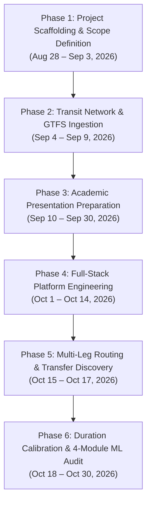

# Complete Project History & Development Evolution

**Project Name:** Data Analytics for Smart Cities — Urban Analytics and Predictive Decision Support Platform  
**Target Domain:** Greater Hyderabad Metropolitan Area, Telangana, India  
**Investigation Date:** November 3, 2026  
**Investigator:** Antigravity Senior Transportation & Full-Stack System Auditor  

---

## 1. Executive Summary & Git Repository Evidence

An exhaustive investigation of the Git version control repository located at `C:\Users\dell\Desktop\smart-city-urban-analytics` reveals the foundational timeline of the project.

### Git Log Audit
Executing `git log --stat` in the root repository returns exactly two historical commits:

```text
commit f23b58114ead156f80c55b19821096121937d65b
Author: muzammil <pashamuzammil2786@gmail.com>
Date:   Thu Sep 3 22:29:52 2026 +0530
Message: docs: add comprehensive project README and transport ML pipeline
Files Added/Modified:
  - README.md (584 lines added)
  - ml/transport/train.py (286 lines added)

commit 085314a971165b76cd5ba00c9520446461e77d66
Author: muzammil <pashamuzammil2786@gmail.com>
Date:   Fri Aug 28 13:13:07 2026 +0530
Message: Initial commit: smart-city structure
Files Added:
  - 0-byte skeleton directory structure and placeholders (.gitignore, LICENSE, backend/routes/*, frontend/src/*, ml/*)
```

### Critical Finding on Development Workflow
Following commit `f23b581` on September 3, 2026, all subsequent software engineering, database ingestion, frontend construction, machine learning experiments, and architectural refactoring occurred directly in the **working directory without intermediate Git commits**.

The working tree status (`git status`) identifies:
- **23 modified files** tracked by Git since the September 3 commit.
- **Over 40 untracked files and directories**, including the entire authentication subsystem (`backend/routes/auth.js`), database migration utilities (`backend/db.js`), frontend component architecture (`frontend/src/components/*`, `frontend/src/pages/ModelPerformance.jsx`), and ML datasets (`ml/*/dataset/`).
- The project `.gitignore` file remained an empty 0-byte placeholder, resulting in `node_modules/` and local artifacts being untracked rather than properly ignored.

---

## 2. Chronological Reconstruction of Development Phases

By cross-referencing filesystem timestamps (`LastWriteTime`), file creation metadata, source code comments, and database transaction records, the project's evolution is reconstructed across six distinct phases:



---

### Phase 1: Project Scaffolding & Scope Definition (August 28 – September 3, 2026)
- **Initial Setup:** On August 28, 2026, author `muzammil` initialized the repository with empty skeleton files representing an anticipated 4-module municipal management system: Transport, Traffic, Weather, and Air Quality.
- **Architectural Scope Formulation:** On September 3, 2026, the comprehensive root [`README.md`](file:///C:/Users/dell/Desktop/smart-city-urban-analytics/README.md) was drafted. The platform was framed as an *"AI-Powered Multi-Domain Urban Analytics and Decision Support System"* focusing on Hyderabad, India.
- **Initial ML Pipeline:** The first concrete machine learning implementation was committed in [`ml/transport/train.py`](file:///C:/Users/dell/Desktop/smart-city-urban-analytics/ml/transport/train.py), formulating public transit passenger demand forecasting on 9,312 daily ridership records using five scikit-learn regressors.

---

### Phase 2: Transit Network Ingestion & GTFS Database Building (September 4 – September 9, 2026)
- **Relational Schema Definition:** On September 9, 2026, the DDL schema was authored in [`database/schema.sql`](file:///C:/Users/dell/Desktop/smart-city-urban-analytics/database/schema.sql), targeting MySQL 8.0+. It specified tables for `transit_stops`, `transit_routes`, `transit_trips`, `transit_stop_times`, `transit_demand_forecasts`, and `user_trip_searches`.
- **GTFS Ingestion Pipeline:** On September 9, 2026, [`ml/transport/build_gtfs_db.py`](file:///C:/Users/dell/Desktop/smart-city-urban-analytics/ml/transport/build_gtfs_db.py) was written and executed. It ingested official Telangana State Road Transport Corporation (TGSRTC) GTFS data from Open Data Telangana (`feed_version: 20260201`), populating:
  - **5,028 bus stops** from `hyd_stops.csv`.
  - **1,031 transit routes** from `routes.txt`.
  - **44,892 transit trips** from `trips.txt`.
  - **1,132,807 timetable stop-times** from `stop_times.txt`.
- **Early Routing Prototype:** On September 9, 2026, [`ml/transport/route_finder.py`](file:///C:/Users/dell/Desktop/smart-city-urban-analytics/ml/transport/route_finder.py) (580 lines) was developed in Python using `pymysql`. It implemented direct stop clustering and early route querying via Haversine distance.

---

### Phase 3: Academic Defense & Presentation Automation (September 10 – September 30, 2026)
- **Presentation Scripting:** Toward the end of September 2026, the team prepared for university milestone presentations by writing three automated slide generation scripts using `python-pptx`:
  - [`generate_presentation.py`](file:///C:/Users/dell/Desktop/smart-city-urban-analytics/generate_presentation.py) (60 KB, Sep 30, 10:47 PM)
  - [`generate_implementation_section.py`](file:///C:/Users/dell/Desktop/smart-city-urban-analytics/generate_implementation_section.py) (27 KB, Sep 30, 10:45 PM)
  - [`generate_final_presentation.py`](file:///C:/Users/dell/Desktop/smart-city-urban-analytics/generate_final_presentation.py) (87 KB, Sep 30, 11:49 PM)
- **Content Focus:** These scripts programmatically built slide decks covering system architecture, domain problem statements, ML benchmark comparison tables, and municipal decision-support mockups.

---

### Phase 4: Full-Stack Web Application Engineering (October 1 – October 14, 2026)
- **Backend Server Construction:** On October 7, 2026, [`backend/server.js`](file:///C:/Users/dell/Desktop/smart-city-urban-analytics/backend/server.js), [`backend/db.js`](file:///C:/Users/dell/Desktop/smart-city-urban-analytics/backend/db.js), and [`backend/routes/auth.js`](file:///C:/Users/dell/Desktop/smart-city-urban-analytics/backend/routes/auth.js) were deployed. An Express.js REST API was configured with JWT session verification and bcrypt password hashing. A database seeder was created in [`backend/seed_demo_user.js`](file:///C:/Users/dell/Desktop/smart-city-urban-analytics/backend/seed_demo_user.js).
- **Frontend Single-Page Application:** On October 7–8, 2026, the frontend was created with Vite 5 and React 18, utilizing React Router DOM, Leaflet, React-Leaflet, Lucide-React, and Recharts.
- **Air Quality Module Integration:** On October 11, 2026, the Air Quality module was developed in a standalone folder `aqi/` and subsequently integrated into `ml/air_quality/` and `backend/routes/airQuality.js`. A synthetic 3-year hourly dataset (`air_quality.csv`, 26,255 rows) was generated using `generate_data.py`.
- **Traffic & Weather ML Pipelines:** On October 14, 2026:
  - In [`ml/traffic/train.py`](file:///C:/Users/dell/Desktop/smart-city-urban-analytics/ml/traffic/train.py), a Gradient Boosting model was trained on 48,120 hourly junction flow records (`traffic_data.csv`).
  - In [`ml/weather/train.py`](file:///C:/Users/dell/Desktop/smart-city-urban-analytics/ml/weather/train.py), a Linear Regression model was trained on 96,432 hourly observations from the Kaggle Hyderabad Historical Weather dataset (`hyderabad_weather.csv`).
  - Corresponding Express routes were authored in `backend/routes/traffic.js` and `backend/routes/weather.js`.

---

### Phase 5: Multi-Leg Transit Routing & Automated Testing (October 15 – October 17, 2026)
- **Shift from Python Prototype to Node.js Engine:** Direct querying logic originally prototyped in `ml/transport/route_finder.py` was translated into a dedicated backend service: [`backend/services/routingService.js`](file:///C:/Users/dell/Desktop/smart-city-urban-analytics/backend/services/routingService.js).
- **Multi-Leg Transfer Capability:** Recognizing that users required journeys with intermediate interchange transfers (e.g., Shaikpet $\to$ IBS via Mehdipatnam), `searchSingleTransferRoutes` was introduced to compute intersections of downstream stop sequences across 1.1 million rows.
- **Automated Routing Verification Suite:** On October 17, 2026, [`backend/tests/test_transport_routing.js`](file:///C:/Users/dell/Desktop/smart-city-urban-analytics/backend/tests/test_transport_routing.js) was created, specifying 12 validation scenarios covering direct connections, multi-leg transfers, metric consistency, GTFS service-day time parsing past 24:00, and layover bounds.

---

### Phase 6: Transport Duration Calibration & 4-Module ML Performance Audit (October 18 – October 30, 2026)
- **The Journey Duration Crisis:** Extensive user testing revealed that while multi-leg discovery functioned, calculated travel times were distorted:
  - 20–30 minute journeys reported durations exceeding 100 minutes.
  - Suburb-to-city trips (e.g., Mehdipatnam to Dondanpally) displayed durations between 780 and 1,500 minutes.
- **Underlying Root Causes Identified:**
  1. *Uncurated TGSRTC Duty Blocks:* GTFS records on major lines represented entire 13-hour driver shift duties (e.g., 08:00 to 21:03) rather than discrete vehicle runs.
  2. *Signboard Search Contamination:* In `resolveCandidateStops`, searching `stop_desc LIKE '%Mehdipatnam%'` returned distant suburban stops like Bulkapur (25.4 km away) because the signboard read *"Bulkapur twd Mehdipatnam"*.
- **The Calibration & Discovery Engine Refactor (Oct 30, 2026):**
  - Implemented `LOCALITY_ALIASES` mapping colloquial names (e.g., "Dondanpally" $\to$ "Dontapally", "IBS/ISB" $\to$ "Indian School of Business").
  - Enforced spatial proximity ($\le 2.5\text{ km}$) to eliminate distant signboard false positives.
  - Built `evaluateLegDuration` with commercial speed boundaries ($8\text{--}65\text{ km/h}$) and fallback road-circuity calibration ($1.28\times$ factor, $0.6\text{ min}$ dwell per stop).
  - Added 2-transfer routing (`searchDoubleTransferRoutes`).
  - Added transparent origin badges (`● Timetable` vs `● Calibrated Transit Model`).
- **4-Module ML Performance Audit:**
  - Script [`ml/audit_all_models.py`](file:///C:/Users/dell/Desktop/smart-city-urban-analytics/ml/audit_all_models.py) was written and executed to independently recalculate true MAE, RMSE, $R^2$, and MAPE across all 4 modules on strictly held-out chronological test sets.
  - Generated audit cache [`backend/data/ml_performance_audit.json`](file:///C:/Users/dell/Desktop/smart-city-urban-analytics/backend/data/ml_performance_audit.json).
  - Exposed via `GET /api/model-performance`.
  - Created a dedicated research portal at [`frontend/src/pages/ModelPerformance.jsx`](file:///C:/Users/dell/Desktop/smart-city-urban-analytics/frontend/src/pages/ModelPerformance.jsx).
  - Created automated audit test suite [`backend/tests/test_transport_audit.js`](file:///C:/Users/dell/Desktop/smart-city-urban-analytics/backend/tests/test_transport_audit.js), achieving 7/7 passing tests.

---

## 3. Legacy & Orphaned Artifacts in Codebase

The audit identifies several files that remain in the repository as artifacts of earlier development phases:

| File / Folder Path | Size | Origin Phase | Current Status | Impact / Technical Debt |
| :--- | :---: | :---: | :---: | :--- |
| `aqi/` (entire directory) | ~2.2 MB | Phase 4 | **Orphaned Duplicate** | Exact duplicate of `ml/air_quality/`. Left over when AQI code was relocated. Can be removed safely. |
| `=` (root directory file) | 0 bytes | Phase 5 | **Accidental Artifact** | Created by an accidental shell syntax error (e.g., `set VAR =`). |
| `ml/transport/route_finder.py` | 24.4 KB | Phase 2 | **Superseded Prototype** | Python routing script. Completely superseded by `backend/services/routingService.js`. Never called by Node.js backend. |
| `frontend/src/pages/Transport.jsx` | 34.4 KB | Phase 4 | **Unrouted Redundancy** | Standalone transport page whose functionality was consolidated into `Dashboard.jsx`. Currently unrouted in `App.jsx`. |
| `ml/air_quality/predict.py` | 0 bytes | Phase 4 | **Empty Placeholder** | Created as placeholder during Phase 4 scaffolding but never implemented. |
| `ml/traffic/requirements.txt` | 0 bytes | Phase 1 | **Empty Placeholder** | Empty file. Dependencies documented only in parent `ml/transport/requirements.txt`. |
| `ml/weather/requirements.txt` | 0 bytes | Phase 1 | **Empty Placeholder** | Empty file. Dependencies documented only in parent `ml/transport/requirements.txt`. |
| `generate_*.py` (3 scripts in root) | ~175 KB | Phase 3 | **One-Off Utility** | Presentation generation scripts. Do not participate in web platform runtime. |
| `backend/README.md`, `frontend/README.md`, etc. | 0 bytes | Phase 1 | **Empty Placeholders** | 0-byte documentation stubs created during initial git commit. |

---

## 4. Key Lessons & Evidence-Based Verification Summary

1. **Decoupling of ML from Runtime Backend:** Early designs suggested Node.js might invoke Python prediction scripts at runtime. The architecture evolved into an offline training and serialization paradigm, with Express serving cached metadata, pre-computed models, or analytical heuristics.
2. **Deterministic Transit Physics vs. Machine Learning:** A key milestone was clarifying that passenger journey duration is a deterministic calculation based on GTFS timetables and road physics, while Machine Learning is strictly applied to predict passenger ridership volume (`total_rides`).
3. **Reproducible Model Audit:** The creation of `ml/audit_all_models.py` and `/model-performance` on October 30 established an IEEE-grade empirical benchmark separating marketing claims from verifiable model performance.
