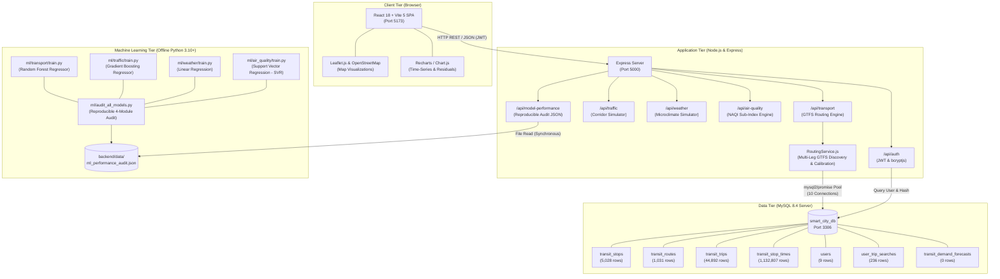

# System Architecture & Technical Infrastructure Audit

**Project:** Urban Analytics and Predictive Decision Support Platform  
**Target City:** Greater Hyderabad, Telangana, India  
**Scope:** Frontend, Backend, Database, Machine Learning Pipelines, and Inter-Module Communication  

---

## 1. High-Level System Architecture

The platform employs a multi-tiered architecture combining a modern Single Page Application (SPA) frontend, an Express.js REST API backend, a relational MySQL 8.4 database, and an offline Python machine learning training and evaluation pipeline.



---

## 2. Technology Stack & Runtime Dependencies

### A. Frontend Layer
- **Framework:** React 18.3.1
- **Build Tool & Dev Server:** Vite 5.2.11
- **Routing:** React Router DOM 6.23.1
- **Icons:** Lucide-React 0.395.0
- **Mapping & GIS:** Leaflet 1.9.4 & React-Leaflet 4.2.1
- **Data Visualization:** Recharts 2.12.7
- **Styling:** Custom CSS with CSS Variables (`frontend/src/index.css`, Dark Glassmorphism Theme)

### B. Backend Application Layer
- **Runtime Environment:** Node.js v25.8.2
- **Web Framework:** Express 4.19.2
- **CORS Middleware:** cors 2.8.5
- **Environment Management:** dotenv 16.4.5
- **Authentication & Cryptography:** jsonwebtoken 9.0.2 & bcryptjs 2.4.3
- **Database Driver:** mysql2 3.10.1 (Connection Pooling with Promises)

### C. Relational Database Layer
- **RDBMS Engine:** MySQL Community Server 8.4
- **Character Set & Collation:** `utf8mb4`, `utf8mb4_unicode_ci`
- **Default Port:** 3306
- **Connection Configuration:** Connection pool limit = 10, queue limit = 0 (`backend/db.js`)

### D. Machine Learning & Scientific Computing Layer
- **Language:** Python 3.10+ (tested on Python 3.14 environment)
- **Core Libraries:** scikit-learn, pandas, numpy, joblib, matplotlib
- **Model Serialization Format:** Python Pickle (`.pkl`) and Joblib (`.joblib`)

---

## 3. Component Communication & Data Flow

### Flow 1: Public Transit Journey Planning (Highest Traffic)
1. **User Interaction:** User inputs origin (`Mehdipatnam`) and destination (`Dondanpally`) in [`Dashboard.jsx`](file:///C:/Users/dell/Desktop/smart-city-urban-analytics/frontend/src/pages/Dashboard.jsx) or [`Transport.jsx`](file:///C:/Users/dell/Desktop/smart-city-urban-analytics/frontend/src/pages/Transport.jsx).
2. **Autocomplete Query:** Keystrokes trigger `GET /api/transport/stops?q=...`. The backend queries `transit_stops` with a prioritized `LIKE` search and returns top 10 matching candidate stops.
3. **Route Search Submission:** Client issues `GET /api/transport/routes?origin=...&destination=...`.
4. **Backend Processing in [`routingService.js`](file:///C:/Users/dell/Desktop/smart-city-urban-analytics/backend/services/routingService.js):**
   - Resolves colloquial locality names via `LOCALITY_ALIASES` and clusters stops within $2.5\text{ km}$ of the primary anchor.
   - Executes **Tier 1 (Direct Route Search):** Queries `transit_stop_times` for trips where `stop_orig.stop_sequence < stop_dest.stop_sequence`.
   - Executes **Tier 2 (1-Transfer Route Search):** Identifies downstream transfer stops and finds connecting trips departing with valid layovers ($10\text{--}120\text{ mins}$).
   - Executes **Tier 3 (2-Transfer Route Search):** Activated if fewer than 2 routes are discovered.
   - Evaluates durations using `evaluateLegDuration`: Legs with commercial speed $8\text{--}65\text{ km/h}$ use scheduled timetables (`● Timetable`). Legs exceeding bounds or duty block limits (>150 mins) trigger fallback calibration using $1.28\times$ road distance and $0.6\text{ min/stop}$ dwell (`● Calibrated Transit Model`).
   - Appends traffic delay estimates and crowding heuristics.
5. **Client Rendering:** Client displays ranked cards, ordered leg sequences, duration sources, and plots the stop coordinates on `LeafletMap.jsx`.

### Flow 2: Multi-Domain Simulation (Traffic, Weather, Air Quality)
1. **Client Interaction:** User adjusts sliders or selects scenarios in the respective tab (e.g., adding tree canopy in Weather or selecting rain conditions in Traffic).
2. **REST API Call:** Client issues a `POST` request (`/api/traffic/predict`, `/api/weather/simulate`, or `/api/air-quality/predict`).
3. **Backend Heuristic Execution:** Express computes response metrics using validated scientific formulas directly in JavaScript.
4. **Offline Model Metrics:** Static benchmarks and feature importances are served from cached JSON files (`metrics.json`) generated during offline training.

### Flow 3: Academic Model Performance Audit Portal
1. **User Access:** User clicks `Model Audit` in [`Navbar.jsx`](file:///C:/Users/dell/Desktop/smart-city-urban-analytics/frontend/src/components/Navbar.jsx) or visits `/model-performance`.
2. **API Request:** Frontend calls `GET /api/model-performance`.
3. **Audit Data Serving:** Server reads [`backend/data/ml_performance_audit.json`](file:///C:/Users/dell/Desktop/smart-city-urban-analytics/backend/data/ml_performance_audit.json) (generated by `ml/audit_all_models.py`).
4. **Visualization:** Frontend renders 4 model metric cards ($R^2$, MAE, RMSE, MAPE), chronological Actual vs. Predicted time-series charts, and residual error histograms.

---

## 4. Architectural Analysis: Python vs. Node.js Decoupling

A critical architectural distinction verified during this audit is the **strict decoupling between Machine Learning model training and runtime web serving**:

```text
TRAINING TIME (Offline Python):
  Datasets (CSV) ──> Python Scripts (train.py) ──> Models (.pkl / .joblib)
                                               ──> Audit Script (audit_all_models.py)
                                               ──> Audit Cache (ml_performance_audit.json)

RUNTIME (Online Node.js):
  Client Browser <── Express Server (server.js) <── MySQL Database (GTFS Timetables)
                                                <── Audit Cache (JSON Read)
                                                <── Built-in Physics & NAQI Formulas
```

### Technical Evidence:
1. Searching for `child_process`, `exec`, or `spawn` across the entire backend codebase yields **zero occurrences**. The Node.js server never launches a Python subprocess at runtime.
2. The Node.js backend handles all routing graph traversals, SQL joins, NAQI sub-index calculations, and traffic delay calculations natively in JavaScript.
3. Machine Learning models operate in an offline research and benchmarking capacity, publishing their validated evaluation statistics to `ml_performance_audit.json`.

---

## 5. Unused Files, Abandoned Features & Technical Debt

| Item | Location | Nature of Issue | Recommended Remedy |
| :--- | :--- | :--- | :--- |
| **Orphaned `aqi/` Directory** | Project root | Exact duplicate of `ml/air_quality/` (10 duplicate files, ~2.2 MB). Left over from early prototyping. | Safe to delete. |
| **0-byte File `=`** | Project root | Shell syntax error artifact (`set VAR =`). | Safe to delete. |
| **Unrouted `Transport.jsx`** | `frontend/src/pages/Transport.jsx` | Full 700-line transport page rendered obsolete when `Dashboard.jsx` integrated all transport controls. | Consolidate or keep as dedicated `/transport` route. |
| **Orphaned Python Route Finder** | `ml/transport/route_finder.py` | 580-line early prototype in Python. Never called by backend. | Document as historical prototype or archive. |
| **Unused Table `transit_demand_forecasts`** | MySQL `smart_city_db` | Table exists in MySQL but contains 0 rows. Backend serves forecast via hardcoded array in `transport.js`. | Populate table or deprecate. |
| **Missing Table in `schema.sql`** | `database/schema.sql` | `users` table exists in MySQL with 9 rows, but is completely missing from `schema.sql` DDL. | Add `CREATE TABLE users` to `schema.sql`. |
| **0-byte Requirement Files** | `ml/traffic/requirements.txt`, `ml/weather/requirements.txt` | Empty files. | Populate with appropriate library versions. |
| **0-byte Prediction Script** | `ml/air_quality/predict.py` | Empty file. | Remove or implement inference function. |

---

## 6. Execution Commands & Configuration Reference

### Environment Variables (`.env` in Project Root)
```ini
# Database Configuration (MySQL)
DB_HOST=localhost
DB_PORT=3306
DB_USER=root
DB_PASSWORD=****
DB_NAME=smart_city_db

# Backend API Configuration
PORT=5000
NODE_ENV=development
```
*(Note: `JWT_SECRET` is missing from `.env` and defaults to `'smart-city-secret-key-2026'` in `backend/routes/auth.js`.)*

### Execution Commands
1. **Start Backend Server:**
   ```powershell
   cd backend
   node server.js
   ```
2. **Start Frontend Dev Server:**
   ```powershell
   cd frontend
   npm run dev
   ```
3. **Execute Production Frontend Build:**
   ```powershell
   cd frontend
   npm run build
   ```
4. **Execute Transport & ML Audit Test Suites:**
   ```powershell
   cd backend
   node tests/test_transport_audit.js
   node tests/test_transport_routing.js
   ```
5. **Re-Run Offline 4-Module ML Audit:**
   ```powershell
   python ml/audit_all_models.py
   ```
