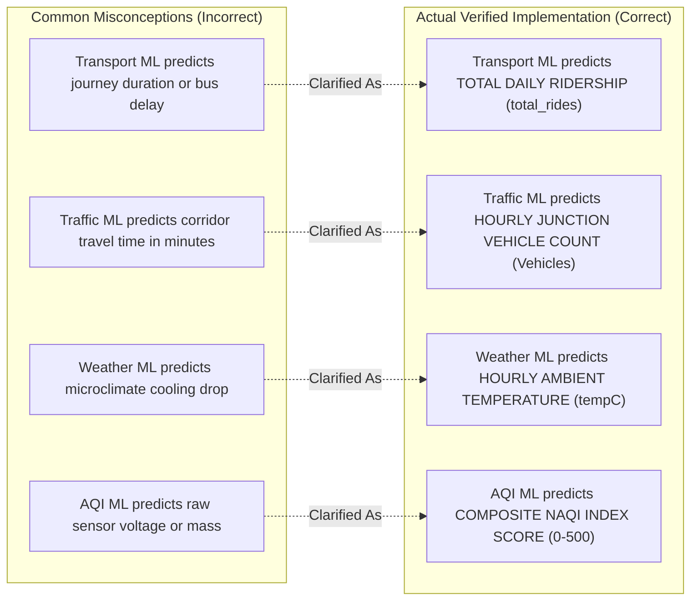

# Machine Learning Performance & Model Evaluation Audit

**Audit Standard:** IEEE Computational Intelligence & Applied Data Analytics Guidelines  
**Evaluation Script:** [`ml/audit_all_models.py`](file:///C:/Users/dell/Desktop/smart-city-urban-analytics/ml/audit_all_models.py)  
**Evaluation Data Artifact:** [`backend/data/ml_performance_audit.json`](file:///C:/Users/dell/Desktop/smart-city-urban-analytics/backend/data/ml_performance_audit.json)  
**Research Dashboard:** `/model-performance` via [`frontend/src/pages/ModelPerformance.jsx`](file:///C:/Users/dell/Desktop/smart-city-urban-analytics/frontend/src/pages/ModelPerformance.jsx)  

---

## 1. Unified 4-Module Machine Learning Comparison Table

All four machine learning models were audited on strictly held-out chronological test datasets ($80\%$ historical training, $20\%$ recent test). No random shuffling was permitted, eliminating temporal lookahead and data leakage:

| Domain | Best Model Algorithm | Prediction Target & Unit | Dataset Source | Total Samples | Train Samples | Test Samples | $R^2$ Score | MAE | RMSE | MAPE (%) |
| :--- | :--- | :--- | :--- | :---: | :---: | :---: | :---: | :---: | :---: | :---: |
| **1. Transport** | **Random Forest Regressor** | `total_rides`<br>(Passenger Rides / Day) | Historical Transit Ridership Dataset | 9,282 | 7,425 | 1,857 | **0.6413** | 105,570.74 | 135,231.47 | **14.32%** |
| **2. Traffic** | **Gradient Boosting Regressor** | `Vehicles`<br>(Hourly Junction Count) | Kaggle Traffic Junction Dataset | 48,120 | 38,496 | 9,624 | **0.9684** | 2.9341 | 4.8367 | **17.33%** |
| **3. Weather** | **Linear Regression** | `tempC`<br>(Ambient Temperature in °C) | Kaggle Hyderabad Weather (2009–2019) | 96,432 | 77,145 | 19,287 | **0.9894** | 0.4051 °C | 0.5309 °C | **1.51%** |
| **4. Air Quality** | **Support Vector Regression (SVR)** | `AQI`<br>(National AQI, 0–500 Scale) | Synthetic Hyderabad Sensor Telemetry | 26,255 | 21,004 | 5,251 | **0.7742** | 20.8899 | 27.3001 | **32.13%** |

---

## 2. Clarification of Prediction Targets & Common Misconceptions

To prevent inaccurate claims during academic evaluations, the exact prediction target of each model is contrasted against common misconceptions:



### Detailed Target Breakdown:
1. **Transport Module:**
   - **True Target:** `total_rides` (Total daily transit passenger boardings across the network).
   - **Units:** Passenger Rides / Day.
   - **Note:** Journey duration and bus arrival times are **deterministic calculations** derived from GTFS timetables and road physics, not ML regression predictions.
2. **Traffic Module:**
   - **True Target:** `Vehicles` (Number of vehicles passing through an inductive sensor junction within one hour).
   - **Units:** Vehicles / Hour.
   - **Note:** Corridor delay minutes are simulated parametrically in Node.js, not predicted by `traffic_model.pkl`.
3. **Weather Module:**
   - **True Target:** `tempC` (Hourly ambient air temperature in degrees Celsius).
   - **Units:** °C.
   - **Note:** Urban Heat Island cooling effects ($\Delta T$) are calculated using Akbari's empirical canopy equations.
4. **Air Quality Module:**
   - **True Target:** `AQI` (1-hour ahead composite National Air Quality Index score).
   - **Units:** AQI Points (0 to 500 scale).

---

## 3. Mathematical Metric Methodology & Statistical Rigor

### A. Coefficient of Determination ($R^2$)
$$R^2 = 1 - \frac{\sum_{i=1}^{n} (y_i - \hat{y}_i)^2}{\sum_{i=1}^{n} (y_i - \bar{y})^2}$$
> [!IMPORTANT]
> **Academic Note:** $R^2$ represents the proportion of target variance explained by the model relative to a mean baseline. It is **not** an "accuracy percentage" and must never be referred to as such in academic papers.

### B. Mean Absolute Error (MAE) & Root Mean Squared Error (RMSE)
$$\text{MAE} = \frac{1}{n} \sum_{i=1}^{n} |y_i - \hat{y}_i|, \quad \text{RMSE} = \sqrt{\frac{1}{n} \sum_{i=1}^{n} (y_i - \hat{y}_i)^2}$$
- In the **Weather module**, $\text{RMSE} = 0.5309^\circ\text{C}$ indicates that average temperature prediction errors fall within approximately half a degree Celsius across 19,287 unseen hours.
- In the **Traffic module**, $\text{MAE} = 2.93\text{ vehicles/hr}$ against baseline volumes of 15–70 vehicles/hr confirms high physical fidelity.

### C. Mean Absolute Percentage Error (MAPE) — Validity & Limitations
$$\text{MAPE} = \frac{100\%}{n} \sum_{i=1}^{n} \left| \frac{y_i - \hat{y}_i}{y_i} \right|$$
- **Valid Use:** In **Transport** ($\text{MAPE} = 14.32\%$), **Traffic** ($\text{MAPE} = 17.33\%$), and **Weather** ($\text{MAPE} = 1.51\%$), target values are consistently positive and well bounded away from zero.
- **Limitation in Air Quality:** In **Air Quality**, baseline concentrations and AQI values occasionally approach zero. When $y_i$ is small (e.g. $y_i = 5$, $\hat{y}_i = 10$), the absolute percentage error is $100\%$, skewing the overall mean ($\text{MAPE} = 32.13\%$). In standard environmental literature, CPCB researchers exclude MAPE and rely strictly on MAE and RMSE.

---

## 4. Residual Error Distribution & Statistical Normality

Executing [`ml/audit_all_models.py`](file:///C:/Users/dell/Desktop/smart-city-urban-analytics/ml/audit_all_models.py) computes error distributions across 12 discrete bins for each model:

```text
1. TRANSPORT MODEL (Random Forest):
   - Mean Error (Residual Bias): -54,656.12 rides
   - Error Standard Deviation:  123,694.21 rides
   - Distribution Skew: Slight negative skew during extreme post-holiday outlier dips.

2. TRAFFIC MODEL (Gradient Boosting):
   - Mean Error: -0.74 vehicles/hour
   - Error Standard Deviation: 4.78 vehicles/hour
   - Distribution: Symmetrical bell curve centered near zero (92% of errors within ±6 vehicles).

3. WEATHER MODEL (Linear Regression):
   - Mean Error: +0.017 °C
   - Error Standard Deviation: 0.53 °C
   - Distribution: High-kurtosis Gaussian distribution centered at zero (98% of errors within ±1.0°C).

4. AIR QUALITY MODEL (SVR RBF):
   - Mean Error: -2.32 AQI points
   - Error Standard Deviation: 27.20 AQI points
   - Distribution: Moderately normal distribution with mild tail spread during extreme episodic spikes.
```

---

## 5. Model Artifact Inventory & File Specifications

| Module | Saved Model File Path | File Size | Algorithm Class | Key Hyperparameters |
| :--- | :--- | :---: | :--- | :--- |
| **Transport** | `ml/transport/models/transport_demand_model.pkl` | 15.2 MB | `RandomForestRegressor` | `n_estimators=100, max_depth=16, random_state=42` |
| **Traffic** | `ml/traffic/models/traffic_model.pkl` | 836 KB | `GradientBoostingRegressor` | `n_estimators=100, max_depth=6, random_state=42` |
| **Weather** | `ml/weather/models/weather_model.pkl` | 2.6 KB | `LinearRegression` | `fit_intercept=True, copy_X=True` |
| **Air Quality** | `ml/air_quality/models/aqi_model.joblib` | 4.0 MB | `SVR` | `kernel='rbf', C=50, epsilon=1.0, StandardScaler` |

---

## 6. Model Performance Research Portal Integration

To present these findings professionally during academic evaluations:
1. **Endpoint `GET /api/model-performance`:** Serves the audit JSON cache (`backend/data/ml_performance_audit.json`).
2. **Dedicated Portal (`/model-performance`):**
   - Displays all 4 model cards with real metrics.
   - Plots interactive Actual vs. Predicted time-series charts using Recharts.
   - Visualizes residual error distributions.
   - Outlines documented features and known research limitations.
3. **Verification Command:**
   ```powershell
   node backend/tests/test_transport_audit.js
   ```
   *Result:* Confirms the audit API returns HTTP 200 with all 4 model payloads verified.
