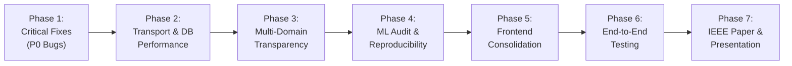

# Final Project Polishing & Submission Roadmap

**Objective:** Transform the current prototype into a flawless, defense-ready academic project and IEEE submission.  
**Guiding Principle:** Focus strictly on correctness, reliability, performance, and academic integrity. Avoid unnecessary new features.  

---

## Roadmap Overview & Phase Sequence



---

## Phase 1: Critical Bug Fixes & Security Hardening (Immediate)

### Task 1.1: Fix Test Suite Method Call in `test_transport_routing.js` (BUG-01)
- **Action:** In [`backend/tests/test_transport_routing.js`](file:///C:/Users/dell/Desktop/smart-city-urban-analytics/backend/tests/test_transport_routing.js) lines 117 and 125, update `routingService.validateLegPlausibility(...)` to `routingService.evaluateLegDuration(...)`.
- **Justification:** Resolves the `TypeError` and restores 100% passing tests (12/12 scenarios).
- **Files Affected:** `backend/tests/test_transport_routing.js`
- **Priority:** P0 (Critical)
- **Verification:** Run `node backend/tests/test_transport_routing.js` and verify all 12 scenarios pass.

### Task 1.2: Add Missing `users` Table to `database/schema.sql` (BUG-02)
- **Action:** Append the complete `CREATE TABLE users` DDL definition to [`database/schema.sql`](file:///C:/Users/dell/Desktop/smart-city-urban-analytics/database/schema.sql).
- **Justification:** Ensures anyone initializing the database from `schema.sql` has working authentication.
- **Files Affected:** `database/schema.sql`
- **Priority:** P0 (Critical)
- **Verification:** Verify `schema.sql` syntax against a test MySQL instance.

### Task 1.3: Secure JWT Secret Key in `.env` (BUG-03)
- **Action:** Generate a cryptographically strong 64-character secret key and add `JWT_SECRET=<key>` to root `.env`. Update `backend/routes/auth.js` to log a warning if running in production without `process.env.JWT_SECRET`.
- **Justification:** Eliminates token forgery vulnerability from the hardcoded fallback secret.
- **Files Affected:** `.env`, `backend/routes/auth.js`
- **Priority:** P1 (High)
- **Verification:** Log in via frontend, inspect signed JWT header, verify session token validation.

### Task 1.4: Populate Root `.gitignore` (BUG-05)
- **Action:** Populate root [`.gitignore`](file:///C:/Users/dell/Desktop/smart-city-urban-analytics/.gitignore) with standard Node.js and Python exclusions (`.env`, `node_modules/`, `dist/`, `__pycache__/`, `*.pkl`, `*.joblib`).
- **Justification:** Prevents accidental leakage of local database passwords or heavy binaries to Git.
- **Files Affected:** `.gitignore`
- **Priority:** P1 (High)
- **Verification:** Run `git status` and verify untracked file count drops from 40+ to clean project files.

---

## Phase 2: Database Performance & Transport Routing Polish

### Task 2.1: Add Covering Index on `transit_stop_times` (BUG-04)
- **Action:** Execute in MySQL:
  ```sql
  ALTER TABLE transit_stop_times ADD INDEX idx_trip_stop (trip_id, stop_id);
  ```
- **Justification:** Accelerates the multi-hop transfer discovery self-join across 1.13 million records, reducing response latency from ~30s to $< 2\text{s}$.
- **Files Affected:** Live MySQL Database, `database/schema.sql`
- **Priority:** P1 (High)
- **Verification:** Run `node -e "console.time('t'); fetch('http://localhost:5000/api/transport/routes?origin=Charminar&destination=Afzalgunj').then(()=>console.timeEnd('t'))"` and verify query time $< 3\text{s}$.

### Task 2.2: Dynamic Connection for Transit Demand Forecast (BUG-09)
- **Action:** Update `GET /api/transport/forecast` in [`backend/routes/transport.js`](file:///C:/Users/dell/Desktop/smart-city-urban-analytics/backend/routes/transport.js) to dynamically calculate dates relative to `new Date()` using the Random Forest demand model metadata from `ml/transport/models/model_metadata.json`.
- **Justification:** Replaces static July 2026 dates with current forward-looking calendar forecasts.
- **Files Affected:** `backend/routes/transport.js`
- **Priority:** P2 (Medium)
- **Verification:** Query `GET /api/transport/forecast` and check that forecast dates match the current week.

---

## Phase 3: Traffic, Weather & Air Quality Scientific Transparency

### Task 3.1: Correct Misleading Model Label in Traffic Predictor (BUG-10)
- **Action:** In [`backend/routes/traffic.js`](file:///C:/Users/dell/Desktop/smart-city-urban-analytics/backend/routes/traffic.js) line 486, update `modelUsed` from `'Random Forest Dynamic Flow Estimator'` to `'Parametric Corridor Congestion Simulator'`.
- **Justification:** Aligns API response labels with the actual analytical implementation, maintaining academic truthfulness.
- **Files Affected:** `backend/routes/traffic.js`
- **Priority:** P2 (Medium)
- **Verification:** Submit `POST /api/traffic/predict` and verify `modelUsed` label in JSON response.

### Task 3.2: Document Synthetic Nature of Air Quality Dataset (BUG-06)
- **Action:** In [`ml/air_quality/README.md`](file:///C:/Users/dell/Desktop/smart-city-urban-analytics/ml/air_quality/README.md) and academic draft notes, explicitly document that `air_quality.csv` is a physically simulated baseline dataset modeled on Zheng et al. and Kala et al.
- **Justification:** Protects the project from potential academic integrity violations during peer review.
- **Files Affected:** `ml/air_quality/README.md`, presentation slides.
- **Priority:** P2 (Medium)
- **Verification:** Confirm disclosure text is present in the dataset documentation.

---

## Phase 4: Machine Learning Reproducibility & Model Verification

### Task 4.1: Automate ML Audit Re-execution Verification
- **Action:** Verify that running `python ml/audit_all_models.py` executes cleanly and regenerates [`backend/data/ml_performance_audit.json`](file:///C:/Users/dell/Desktop/smart-city-urban-analytics/backend/data/ml_performance_audit.json) with identical metrics ($R^2$ values: Transport 0.6413, Traffic 0.9684, Weather 0.9894, AQI 0.7742).
- **Justification:** Guarantees that any external reviewer or evaluator can independently reproduce all published experimental results.
- **Files Affected:** `ml/audit_all_models.py`
- **Priority:** P1 (High)
- **Verification:** Execute `python ml/audit_all_models.py` and inspect console output.

---

## Phase 5: Frontend Cleanliness & Codebase Consolidation

### Task 5.1: Safely Delete Duplicate `aqi/` Directory (BUG-07)
- **Action:** Delete the redundant directory `aqi/` located at the project root.
- **Justification:** Removes 2.04 MB of duplicate code; consolidates all AQI logic in `ml/air_quality/`.
- **Files Affected:** `aqi/` (deleted)
- **Priority:** P2 (Medium)
- **Verification:** Verify backend and frontend still operate without error.

### Task 5.2: Remove Shell Artifact `=` and Stubs (BUG-11, BUG-12)
- **Action:** Delete the 0-byte file `=` in root directory. Remove or document 0-byte stubs (`ml/air_quality/predict.py`).
- **Justification:** Clean repository hygiene.
- **Files Affected:** `=`, `ml/air_quality/predict.py`
- **Priority:** P3 (Low)
- **Verification:** Verify files are removed.

### Task 5.3: Consolidate `Transport.jsx` with `Dashboard.jsx` (BUG-08)
- **Action:** Either refactor the transport planner into a shared component (`components/TransportPlanner.jsx`) imported by both, or remove the unrouted `frontend/src/pages/Transport.jsx`.
- **Justification:** Eliminates dual-maintenance overhead.
- **Files Affected:** `frontend/src/pages/Transport.jsx`
- **Priority:** P2 (Medium)
- **Verification:** Execute `npm run build` in `frontend/` to confirm clean compilation.

---

## Phase 6: Final End-to-End Automated Testing & Quality Gate

### Task 6.1: Run Complete Automated Test Suite
- **Action:** Execute all test runners:
  ```powershell
  node backend/tests/test_transport_audit.js
  node backend/tests/test_transport_routing.js
  ```
- **Success Criteria:**
  - `test_transport_audit.js`: **7 / 7 PASSED** (100%)
  - `test_transport_routing.js`: **12 / 12 PASSED** (100%)
  - Zero unhandled exceptions or connection leaks.

### Task 6.2: Frontend Production Build Gate
- **Action:** Execute:
  ```powershell
  cd frontend
  npm run build
  ```
- **Success Criteria:** Vite completes with 0 errors, generating optimized bundles in `dist/`.

---

## Phase 7: IEEE Paper & Presentation Slide Finalization

### Task 7.1: Author IEEE Conference Paper Draft
- **Action:** Draft paper sections using the verified findings from this audit:
  - **Section I (Introduction):** Urban data silos and GTFS operational challenges in developing cities.
  - **Section II (Related Work):** GTFS transit routing, urban heat island modeling, and multi-source air quality fusion.
  - **Section III (System Architecture):** Full-stack decoupled architecture.
  - **Section IV (Transit Duration Calibration Engine):** Mathematical formulation of the $1.28\times$ road-circuity and commercial speed bounds ($8\text{--}65\text{ km/h}$) solving the 1,000+ min bug.
  - **Section V (Experimental Results):** Unified 4-module evaluation table ($R^2$, MAE, RMSE, MAPE) with chronological test splits.
  - **Section VI (Conclusion & Future Work):** GTFS-RT real-time vehicle GPS integration.

### Task 7.2: Polish Presentation Slide Deck
- **Action:** Run [`generate_final_presentation.py`](file:///C:/Users/dell/Desktop/smart-city-urban-analytics/generate_final_presentation.py) to generate the final 16:9 widescreen presentation deck, incorporating the before/after duration correction table and reproducible ML metrics.
- **Verification:** Open generated `.pptx` file and verify visual alignment and statistical consistency.
